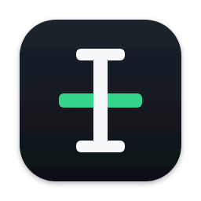
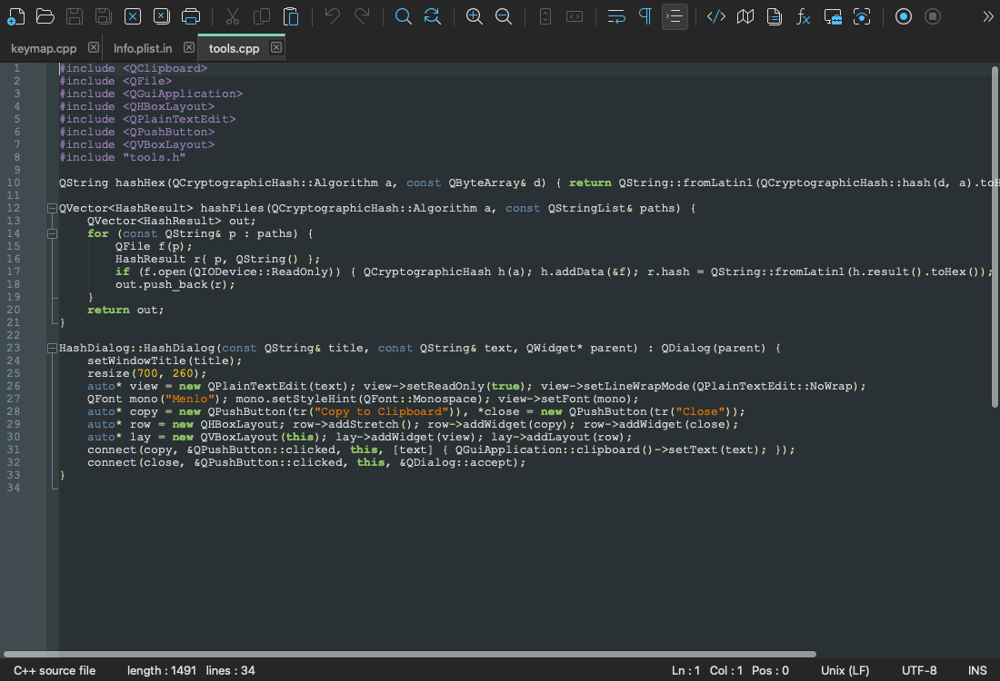

# PadPlus for Mac

**A native macOS source code editor for Apple Silicon, based on the Notepad++ source code.** It is built with Qt 6 around the same editing engine (Scintilla), lexers, themes, settings files and macros.

[](https://github.com/CristianVertiz/PadPlus/releases/latest)&nbsp;&nbsp;[](https://github.com/CristianVertiz/PadPlus/actions/workflows/macos.yml)&nbsp;&nbsp;[](LICENSE)



> PadPlus is an independent personal project. It is **not affiliated with, endorsed by or supported by the Notepad++ project**, which supports Windows only.
> Please report problems with PadPlus [here](https://github.com/CristianVertiz/PadPlus/issues), not to Notepad++.

## Install

1. Download `PadPlus-<version>-arm64.dmg` from the [latest release](https://github.com/CristianVertiz/PadPlus/releases/latest).
2. Open it and drag **PadPlus** to **Applications**.
3. The app is not notarized by Apple, so macOS blocks the first launch. Allow it once, either in
   **System Settings > Privacy & Security > Open Anyway**, or with:

   ```sh
   xattr -dr com.apple.quarantine /Applications/PadPlus.app
   ```

Requirements: an Apple Silicon Mac running macOS 15 or later. Each release comes with a SHA-256 file to check the download against.
Building it yourself avoids the first-launch step: see [Build from source](#build-from-source).

## What you get

- **Editing:** tabs in two views, syntax highlighting and folding for about 90 languages, 22 themes with dark mode, multi-encoding and line-ending support, session restore.
- **Search:** Find / Replace with regular expressions, Find in Files, incremental search, bookmarks, Mark, styled tokens, Find Characters in Range.
- **Tools:** macros (record, save, run many times), Column Editor, MD5 / SHA hashes, printing, Run menu, file monitoring (tail -f).
- **Panels:** Function List, Folder as Workspace, Document List, Document Map, Clipboard History, ANSI Chars.
- **Customising:** Preferences, Style Configurator, Shortcut Mapper, user defined languages with an editor, menus in about 90 languages.
- **Compatible settings:** `config.xml`, `stylers.xml`, `shortcuts.xml`, sessions and language definitions use the Windows formats, so they can be copied between a PC and a Mac.

## What is missing

- **Plugins.** Notepad++ plugins are Windows DLLs and cannot load on macOS.
- Translated dialog contents (menus and toolbar are translated), searches inside macros, an in-app update check.
- Intel Macs and macOS older than 15.

The complete list is in [Known gaps](macos/README.md#known-gaps).

## Build from source

```sh
brew install cmake ninja qt
cmake -S macos -B macos/build -G Ninja -DCMAKE_PREFIX_PATH="$(brew --prefix)"
cmake --build macos/build
open macos/build/PadPlus.app
```

The [developer guide](macos/README.md) covers packaging, tests, continuous integration and releases.

## How this relates to Notepad++

- The `master` branch mirrors [notepad-plus-plus/notepad-plus-plus](https://github.com/notepad-plus-plus/notepad-plus-plus). The port lives in the `macos` branch, almost entirely in the [`macos/`](macos) folder.
- About 160,000 lines are Notepad++, Scintilla and Lexilla code compiled as they are; a handful of upstream files carry small portability edits. The Windows user interface is replaced by a Qt one of a few thousand lines. [What is reused, ported and new](macos/REUSE_PORT_NEW.md) has the breakdown.
- This port is not intended for merging upstream.

## Licence

GPL v3, like Notepad++: see [LICENSE](LICENSE). Bundled components and their licences are listed in the [third-party notices](macos/THIRD_PARTY_NOTICES.md).
"Notepad++" is the name of the original project and belongs to it; it is used here only to say what PadPlus is based on. The original project and its own README are at [notepad-plus-plus/notepad-plus-plus](https://github.com/notepad-plus-plus/notepad-plus-plus). The port was written with AI assistance (Claude Code).
